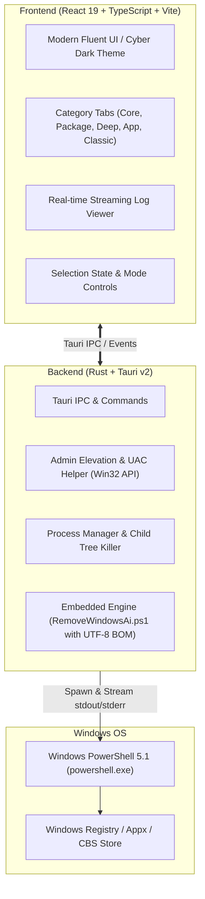

# ⚡ KANAO Remove AI

[](https://github.com/adisorn6302565/KANAO-Remove-AI/actions/workflows/build.yml)


**GUI สำหรับปิด / ลบฟีเจอร์ AI ใน Windows 10/11** (Copilot, Recall, AI ใน Paint/Notepad/Snipping Tool ฯลฯ) ด้วยคลิกเดียว พัฒนาใหม่ด้วยสถาปัตยกรรม **Rust + React + TypeScript + Tauri v2**

A modern desktop GUI for the [RemoveWindowsAI](https://github.com/zoicware/RemoveWindowsAI) engine by **@zoicware** — lightweight, native, fast, and secure.

> ⚠️ เครื่องมือนี้มีการปรับแต่ง Registry, ลบแพ็กเกจระบบ และไฟล์ของระบบ แนะนำให้เปิด **Backup Mode** (สร้างจุด System Restore ก่อน) ทุกครั้ง

---

## 🇹🇭 วิธีติดตั้งและใช้งาน (ภาษาไทย)

**ไม่ต้องติดตั้ง** สามารถดาวน์โหลดไฟล์ EXE เดียว เปิดใช้งานได้ทันที

1. ไปที่หน้า [**Releases ล่าสุด**](../../releases/latest)
2. ดาวน์โหลด **`kanao-remove-ai.exe`**
3. ดับเบิลคลิกไฟล์ → กด **Yes** ที่หน้าต่าง UAC (ต้องใช้สิทธิ์ Administrator)
   - หาก Windows SmartScreen เตือน ให้กด **More info → Run anyway**
4. เลือกโหมด:
   - **Backup Mode**: สร้างจุด System Restore ก่อนทำการปรับแต่ง (แนะนำอย่างยิ่ง)
   - **Revert Mode**: ย้อนกลับการตั้งค่าและกู้คืนฟีเจอร์ที่เคยปิดไว้
5. เลือกฟีเจอร์ AI ที่ต้องการปิด หรือ Classic Apps ที่ต้องการกู้คืน → กด **⚡ Apply Changes**
6. ดูการทำงานสดๆ ได้ใน **Execution Console** ด้านล่าง
7. เมื่อเสร็จสิ้น สามารถกด **Restart PC Now** เพื่อให้ระบบรีสตาร์ทและมีผลสมบูรณ์

---

## 🏗️ สถาปัตยกรรมระบบ (Architecture)

ระบบเดิมที่เป็น C# WPF (.NET 8) ได้รับการปรับเปลี่ยนเป็นโครงสร้างใหม่ทั้งหมด:



---

## ✨ รายการฟีเจอร์ (Features)

### 🔑 Core AI Removal
- **Disable AI Registry Keys**: ปิด Copilot, Recall, Input Insights, AI Actions, Voice Access, AI Voice Effects, Gaming AI, Office AI และ AI ใน Settings Search
- **Disable Copilot Policies**: ปรับแก้ `IntegratedServicesRegionPolicySet.json` เพื่อปิด Policy ทั้งหมดของ Copilot
- **Hide AI Components**: ซ่อนหน้าการตั้งค่า AI Components ออกจากหน้า Windows Settings

### 📦 Package Removal
- **Remove AI Appx Packages**: ถอนการติดตั้งแพ็กเกจ Appx ที่เกี่ยวข้องกับ AI รวมถึง Inbox packages
- **Remove AI CBS Packages**: ลบแพ็กเกจใน Component-Based Servicing store
- **Prevent AI Reinstall**: ป้องกัน Windows Update ติดตั้งแพ็กเกจ AI กลับคืนมา

### 🧹 Deep Clean
- **Remove AI Files & Folders**: ลบโฟลเดอร์ติดตั้ง Appx, Machine Learning DLLs, ตัวติดตั้ง Copilot ที่ซ่อนอยู่
- **Remove Recall Feature**: ปิดการทำงานและลบฟีเจอร์ Windows Recall ออกทั้งหมด (DisabledWithPayloadRemoved)
- **Remove Recall Tasks**: ลบ Scheduled Tasks ของ Recall ด้วยสิทธิ์ระดับระบบ

### 📝 App Specific
- **Disable Notepad AI Rewrite**: ปิดฟีเจอร์ AI Rewrite ใน Windows Notepad

### 🎨 Classic Windows Apps (Restoration)
- **Classic Photo Viewer**: กู้คืน Windows Photo Viewer คลาสสิก
- **Classic Paint**: กู้คืน Paint ดั้งเดิม (mspaint.exe)
- **Classic Snipping Tool**: กู้คืน Snipping Tool รุ่นคลาสสิก
- **Classic Notepad**: กู้คืน Notepad ดั้งเดิมที่ไม่มี AI
- **Photos Legacy**: ติดตั้ง Microsoft Photos Legacy

---

## 🛠️ วิธี Build จาก Source Code

### สิ่งที่ต้องมีในเครื่อง:
1. **Node.js** (v18+ แนะนำ v20 หรือ v22)
2. **Rust & Cargo** (v1.78+)
3. **Windows 10 / 11**

### ขั้นตอนการ Build:
```bash
# 1. ติดตั้ง Dependencies
npm install

# 2. ทดสอบรัน Development Mode
npm run tauri dev

# 3. Build ไฟล์ Release EXE
npm run tauri build
# หรือดับเบิลคลิกไฟล์ build.bat
```

ไฟล์ Binary ที่ได้จะอยู่ที่: `src-tauri/target/release/kanao-remove-ai.exe`

---

## 📜 Credits & License

- Original Engine: [RemoveWindowsAI](https://github.com/zoicware/RemoveWindowsAI) by **@zoicware**
- Frontend & Tauri Port: **KANAO**
- Distributed under the MIT License. See [THIRD_PARTY_NOTICES.md](THIRD_PARTY_NOTICES.md) for details.
